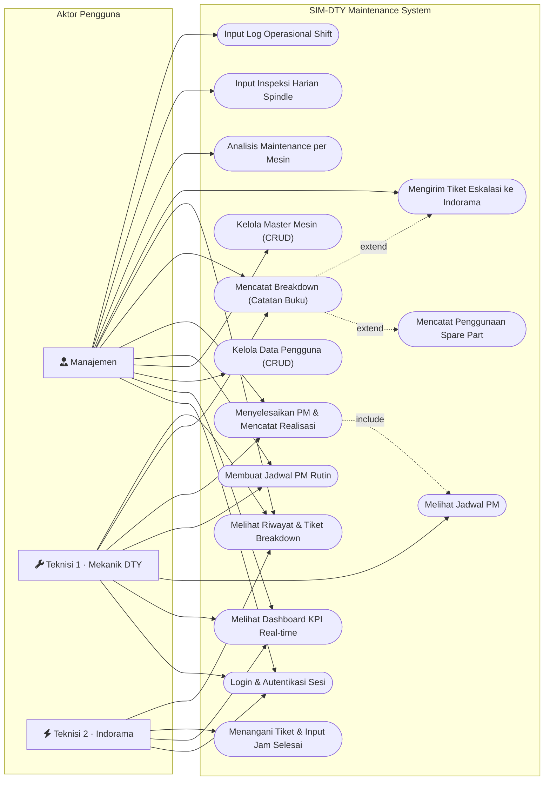
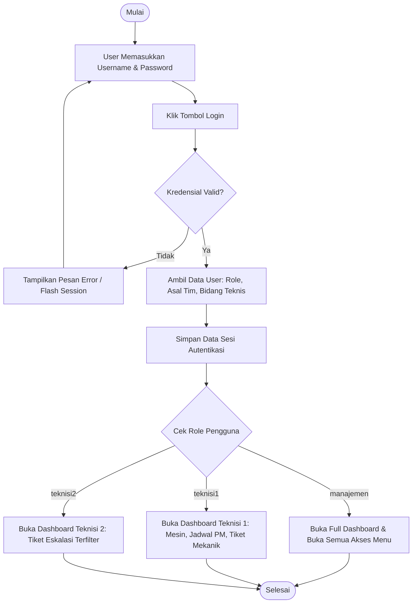
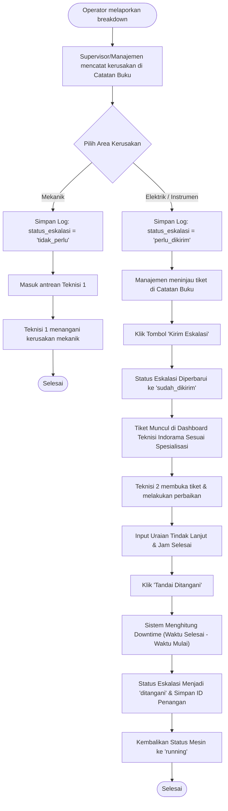
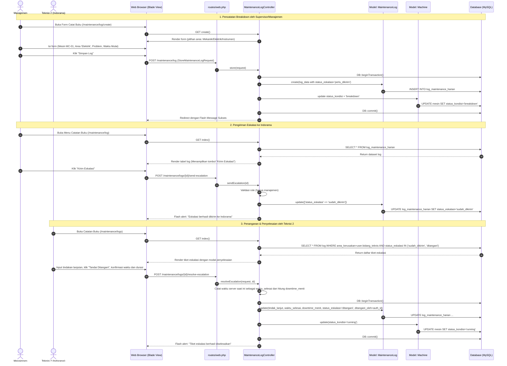
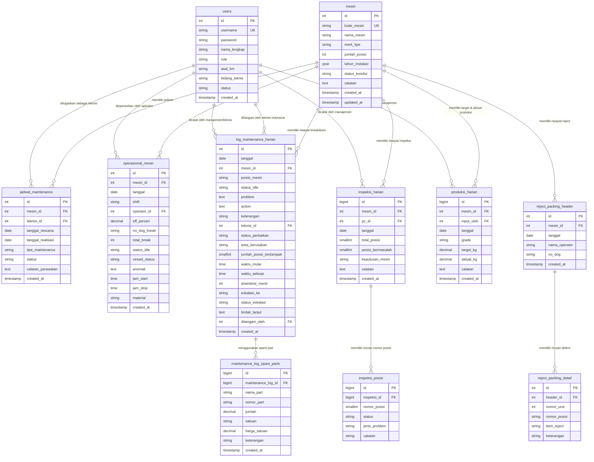

# SIM-DTY Maintenance
> **Sistem Informasi Manajemen Mesin & Maintenance DTY**  
> PT Indorama Polychem Indonesia (PEI) ↔ PT Indo-Rama Synthetics Tbk (IPSI)

Aplikasi berbasis web untuk mengelola maintenance mesin **Draw Texturing Yarn (DTY)** — mencakup jadwal preventive maintenance, catatan breakdown harian, penanganan tiket, inspeksi spindle, dan laporan mesin. QC dan pencatatan produksi bukan bagian dari aplikasi maintenance aktif.

**Stack:** Laravel 11 · PHP 8.2+ · MySQL · Blade Templating · Session Auth

---

## Daftar Isi

- [Gambaran Sistem](#gambaran-sistem)
- [Menjalankan di Laragon](#menjalankan-di-laragon)
- [Akun Demo](#akun-demo)
- [Alur Penggunaan](#alur-penggunaan)
- [Fitur](#fitur)
- [Model dan Relasi](#model-dan-relasi)
- [Arsitektur & Alur Sistem](#arsitektur--alur-sistem)
- [Peran Pengguna (Role)](#peran-pengguna-role)
- [Perancangan Sistem (UML & ERD)](#perancangan-sistem-uml--erd)
- [Kelebihan Sistem](#kelebihan-sistem)
- [Kekurangan & Rekomendasi Pengembangan](#kekurangan--rekomendasi-pengembangan)
- [Prompt Laporan Praktikum](#prompt-laporan-praktikum)

---

## Gambaran Sistem

Mesin DTY beroperasi **24 jam / 3 shift** dengan ratusan posisi spindle per unit. Tanpa sistem terpusat, pencatatan breakdown dan jadwal PM dilakukan manual di buku fisik — rawan kehilangan data dan sulit dipantau Manajemen secara real-time.

**SIM-DTY Maintenance** hadir sebagai solusi digital dengan:

| Masalah Lama | Solusi Sistem |
|---|---|
| Buku catatan manual, mudah hilang | Log digital dengan riwayat tersimpan |
| Jadwal PM tidak terpantau | Pencatatan jadwal perawatan dan penandaan jadwal terlambat |
| Eskalasi via telepon/pesan | Tiket eskalasi berbasis role otomatis |
| Tidak ada KPI operasional | Dashboard kondisi mesin, EFF, downtime, dan PM terlambat |
| Data mesin tersebar | Laporan per mesin dengan filter periode untuk analisis operasi dan maintenance |

---

## Menjalankan di Laragon

Pastikan PHP 8.2+, Composer, ekstensi `pdo_mysql`, dan MySQL aktif. Dari folder project:

```powershell
composer install
Copy-Item .env.example .env
php artisan key:generate
```

Atur `DB_HOST`, `DB_PORT`, `DB_DATABASE`, `DB_USERNAME`, dan `DB_PASSWORD` pada `.env`.

Untuk database baru, buat database `db_dty_maintenance` di MySQL, lalu jalankan:

```powershell
php artisan migrate --seed
```

Untuk database native yang sudah ada, arahkan `.env` ke database yang sama lalu jalankan `php artisan migrate`. Migration mengenali tabel `users` yang sudah ada dan tidak membuat ulang schema; data lama tetap digunakan. Modul Surat Jalan sudah dihapus dari aplikasi dan schema instalasi baru. Jika database lama memiliki tabel `pengiriman_dty`, migrasi tidak menghapusnya agar riwayat lama tidak hilang. Jangan jalankan seeder pada database lama karena akun dan mesin demo sudah ada.

Jalankan aplikasi:

```powershell
php artisan serve
```

Buka `http://127.0.0.1:8000`.

## Akun Demo

Untuk instalasi database baru yang dijalankan dengan `php artisan migrate --seed`, gunakan akun demo berikut:

| Role | Username | Password awal | Hak akses utama |
| --- | --- | --- | --- |
| Manajemen | `manajemen` | `admin123` | Akses semua modul; mengelola user, master mesin, dan jadwal maintenance |
| Teknisi 1 · Mekanik DTY | `teknisi1` | `admin123` | Melihat jadwal, menyelesaikan PM, dan menangani tiket mekanik |
| Teknisi 2 · Indorama | `teknisi2` | `admin123` | Menerima eskalasi elektrik/instrumen sesuai bidang dan mencatat tindak lanjut |

Akun di atas hanya dibuat oleh seeder untuk database baru. Jika menggunakan database yang sudah berisi data, gunakan akun yang sudah terdaftar; jangan jalankan seeder pada database tersebut. Password demo ditujukan untuk pengujian lokal dan harus diganti sebelum aplikasi digunakan di lingkungan bersama atau produksi.

## Alur Penggunaan

### 1. Login dan siapkan akun

1. Jalankan aplikasi dan buka `http://127.0.0.1:8000`.
2. Masukkan **Username** dan **Password** sesuai akun demo di atas, lalu login. Menu yang tersedia disesuaikan dengan role akun.
3. Untuk membuat akun, login sebagai Manajemen, buka **Manajemen User**, lalu pilih **Tambah User**.
4. Untuk teknisi lokal, pilih role **Teknisi 1**. Tim dan bidangnya otomatis ditetapkan sebagai DTY/Mekanik.
5. Untuk petugas Indorama, pilih role **Teknisi 2** lalu spesialisasi **Elektrik** atau **Instrumen**.
6. Setelah selesai menggunakan aplikasi, pilih **Logout/Keluar** untuk mengakhiri sesi.

### 2. Catat pemeriksaan harian

1. Manajemen membuka **Inspeksi Spindle** lalu **Catat Inspeksi**.
2. Pilih mesin dan tanggal. Jumlah posisi mesin terisi dari data master.
3. Tambahkan nomor spindle yang bermasalah beserta jenis problem. Posisi yang tidak dicatat dianggap normal.
4. Pilih keputusan **Tetap running** atau **Stop untuk perbaikan** berdasarkan kondisi aktual. Aplikasi memberi saran mempertimbangkan stop jika lebih dari 20 posisi bermasalah, tetapi keputusan tetap pada petugas.
5. Catat performa tiap shift di **Shift & EFF**.

### 3. Tangani breakdown dan eskalasi

1. Operator melaporkan keluhan kerusakan mesin kepada Supervisor/Manajemen.
2. Supervisor/Manajemen memeriksa laporan dan mencatat mesin, posisi, jumlah posisi terdampak, kategori kerusakan, problem, waktu mulai, dan tindakan awal di **Catatan Buku**.
   Status perbaikan tidak diisi di form; setelah log disimpan sistem otomatis menandainya **Sedang diperbaiki**.
3. Status eskalasi ditentukan otomatis berdasarkan bagian kerusakan: **Mekanik** ditangani teknisi DTY/PI, sedangkan **Elektrik/Instrumen** dapat diteruskan ke teknisi Indorama bila membutuhkan bantuan.
4. Untuk **Elektrik** atau **Instrumen**, Supervisor/Manajemen meneruskan eskalasi agar tiket tersedia bagi Teknisi 2 yang spesialisasinya cocok.
5. Setelah eskalasi dikirim, teknisi Indorama melihat tiket sesuai bidangnya. Badge aplikasi menunjukkan tiket baru saat halaman dibuka atau dimuat ulang.
6. Teknisi lokal atau Indorama mencatat penyelesaian pada tiketnya. Sebelum konfirmasi, sistem menampilkan waktu mulai, waktu selesai saat ini, serta durasi; server mencatat waktu selesai dan menghitung downtime saat tiket dikonfirmasi selesai.

### 4. Jalankan preventive maintenance

1. Manajemen/Supervisor atau Teknisi DTY membuka **Jadwal** → **Buat Jadwal**.
2. Pilih mesin, tanggal rencana, dan teknisi mekanik DTY. Teknisi Indorama tidak ditugaskan pada PM rutin.
3. Setelah pekerjaan selesai, teknisi DTY/Manajemen menekan **Tandai selesai**, lalu mencatat hasil pemeriksaan dan spare part yang benar-benar diganti. Catatan hasil tersimpan di riwayat PM.
4. Dashboard menghitung pengingat PM rutin berikutnya dua bulan dari realisasi PM rutin terakhir. Pengingat tidak ditampilkan jika jadwal berikutnya sudah dibuat. Sistem tidak membuat jadwal otomatis; Supervisor/Manajemen membuat jadwal berikutnya secara manual.

### 5. Pantau hasil

Dashboard menampilkan kondisi mesin, downtime, PM terlambat, pengingat PM rutin dua bulanan, dan eskalasi tertunda. Daftar mesin menampilkan sumber status **Breakdown** dari log perbaikan yang belum selesai; bila tidak ada catatan tertaut, sistem menyatakannya. Setelah semua log perbaikan mesin selesai, sistem mengembalikan status ke **Running**. Status operasional tidak perlu diedit langsung pada master mesin. Daftar jadwal membagi data ke dua card vertikal: **Belum Selesai** (merah, di atas) dan **Sudah Selesai** (hijau, di bawah). Card selesai diurutkan berdasarkan waktu penyelesaian terbaru. Buka **Laporan Mesin** untuk membandingkan metrik tiap mesin pada rentang tanggal tertentu dan meninjau riwayat maintenance. **Manajemen/Supervisor** mengelola jadwal, mencatat keluhan operator, serta memantau; teknisi menangani perbaikan.

## Fitur

- Autentikasi session Laravel, token CSRF, validasi request, dan pembatasan role.
- CRUD master mesin dan pengelolaan jadwal preventive secara terpisah.
- Jadwal PM rutin mengikuti siklus dua bulanan sebagai pengingat berdasarkan realisasi terakhir; jadwal berikutnya tetap dibuat manual, tidak dibuat otomatis.
- Penyelesaian jadwal PM menyimpan hasil pekerjaan dan spare part yang diganti dalam catatan realisasi.
- Catatan maintenance dan log operasional shift.
- Inspeksi harian untuk seluruh spindle mesin; posisi bermasalah dicatat per nomor dan posisi lainnya dianggap normal.
- Breakdown mencatat kategori mekanik/elektrik/instrumen, jumlah posisi terdampak, waktu mulai, downtime, dan status eskalasi. Waktu selesai dicatat saat teknisi menyelesaikan tiket.
- Status perbaikan tidak dapat dipilih saat input log. Log baru otomatis berstatus **Sedang diperbaiki**; Teknisi DTY/Manajemen menyelesaikan kerusakan mekanik dari dashboard atau Catatan Buku, sedangkan tiket eskalasi diselesaikan Teknisi Indorama.
- Teknisi DTY dibatasi ke tiket mekanik; teknisi Indorama dibatasi ke tiket elektrik/instrumen yang sudah dikirim. Tim Indorama tidak dapat mengubah PM lokal.
- Pemberitahuan dalam aplikasi menampilkan jumlah eskalasi baru yang menunggu pada Teknisi Indorama sesuai bidangnya. Pemberitahuan diperbarui saat halaman dimuat; email, WhatsApp, dan push notification tidak termasuk.
- Dashboard merangkum kondisi mesin, posisi bermasalah, downtime, PM terlambat, serta eskalasi yang belum ditangani.
- Laporan mesin dapat difilter berdasarkan rentang tanggal dan mesin, dengan ringkasan operasi shift, kerusakan, inspeksi, dan preventive maintenance.
- Catatan operasi mencegah duplikasi untuk kombinasi mesin, tanggal, dan shift.
- Manajemen akun dan role hanya dapat dibuka oleh Manajemen.
- Riwayat spare part per kejadian maintenance, termasuk jumlah, satuan, nomor part, dan harga.
- Schema tersedia melalui Laravel migration; seeder menyediakan akun demo dan data mesin awal.

## Model dan Relasi

| Model | Relasi utama |
| --- | --- |
| `User` | Memiliki `asal_tim` dan `bidang_teknis`; `hasMany` jadwal/log sebagai teknisi, tiket yang ditangani, operasi, dan inspeksi |
| `Machine` | `hasMany` jadwal, log maintenance, inspeksi, dan log operasional |
| `MaintenanceSchedule` | `belongsTo` mesin dan teknisi (`User`) |
| `MaintenanceLog` | `belongsTo` mesin, teknisi pencatat, dan handler; `hasMany` detail spare part; menyimpan kategori dan downtime breakdown |
| `MaintenanceLogSparePart` | `belongsTo` log maintenance |
| `MachineOperation` | `belongsTo` mesin dan operator (`User`) |
| `DailyInspection` | `belongsTo` mesin dan pencatat; `hasMany` posisi inspeksi |
| `InspectionPosition` | `belongsTo` inspeksi harian |

Model aktif berada di `app/Models`. Tabel produksi dan QC dari skema versi lama tetap dipertahankan oleh migration untuk menjaga data historis, tetapi model, route, dan fitur inputnya tidak termasuk aplikasi aktif.

## Contoh MVC

- Dashboard Eloquent: `app/Http/Controllers/DashboardController.php` memuat KPI dan relasi mesin/teknisi untuk `resources/views/dashboard.blade.php`.
- Log maintenance: `app/Http/Requests/StoreMaintenanceLogRequest.php` memvalidasi header dan array spare part; `app/Http/Controllers/MaintenanceLogController.php` menyimpan log beserta detail spare part di dalam transaksi.
- Eskalasi: Manajemen mengirim tiket elektrik/instrumen; hanya Teknisi 2 dengan spesialisasi yang sesuai dapat melihat serta menyelesaikannya. Waktu selesai dicatat server saat teknisi mengonfirmasi penyelesaian.
- Form input: `resources/views/maintenance/logs/create.blade.php` menyediakan catatan problem/action dan baris spare part dinamis.
- Riwayat: `resources/views/maintenance/logs/index.blade.php` menampilkan relasi mesin, teknisi, dan spare part.
- Inspeksi spindle: `app/Http/Requests/StoreDailyInspectionRequest.php` memeriksa rentang/duplikasi posisi; `app/Http/Controllers/DailyInspectionController.php` menyimpan header dan detail dalam transaksi.
- Manajemen role: CRUD akun tersedia di `app/Http/Controllers/UserController.php` dan dibatasi oleh middleware route `role:manajemen`.

---

## Arsitektur & Alur Sistem

### Arsitektur MVC (Laravel)

```
Browser (User)
    │
    ▼
routes/web.php          ← Routing + Middleware Role Guard
    │
    ▼
Controllers/            ← Logika bisnis & validasi request
    ├── PortalController.php      (Auth, Mesin, Jadwal, Operasional)
    ├── DashboardController.php   (Agregat KPI)
    ├── MachineReportController.php (Ringkasan lintas mesin dan riwayat maintenance)
    ├── MaintenanceLogController.php  (Catatan Buku + Eskalasi)
    ├── DailyInspectionController.php (Inspeksi Spindle)
    └── UserController.php        (CRUD User — Manajemen only)
    │
    ▼
Database (MySQL)        ← Query Builder / DB::table()
    │
    ▼
Views (Blade)           ← shared/index, shared/form, dashboard, print
```

### Alur Bisnis Utama

```
┌─────────────────────────────────────────────────────────────────┐
│                      SIKLUS OPERASIONAL HARIAN                  │
└─────────────────────────────────────────────────────────────────┘

  [LOGIN] ──► Role dideteksi ──► Menu ditampilkan sesuai hak akses

  Manajemen mencatat operasional setiap shift:
  ┌──────────────────────────────────────────────┐
  │  1. Inspeksi Spindle                         │
  │     - Pilih mesin + tanggal                  │
  │     - Input nomor spindle bermasalah         │
  │     - Pilih: Tetap Running / Stop            │
  │     * Sistem saran: Stop jika >20 posisi     │
  │                                              │
  │  2. Log Operasional Shift                    │
  │     - Input EFF%, break, vessel, anomali     │
  │     - Per shift: Shift 1/2/3                 │
  │                                              │
  │  QC dan produksi bukan bagian dari alur      │
  │  aplikasi maintenance aktif                 │
  └──────────────────────────────────────────────┘

  BREAKDOWN terjadi:
  ┌──────────────────────────────────────────────┐
  │  Supervisor/Manajemen mencatat keluhan       │
  │       ──► [Catatan Buku / Catat Log]         │
  │     - Isi: mesin, posisi, problem, action    │
  │     - Pilih area kerusakan:                  │
  │       Mekanik / Elektrik / Instrumen         │
  │     * Teknisi 1 menangani area mekanik       │
  │                                              │
  │  Jika area = Mekanik:                        │
  │     └──► status_eskalasi = null              │
  │          Teknisi 1 dapat                    │
  │          melihat tiket ini di Catatan Buku   │
  │                                              │
  │  Jika area = Elektrik / Instrumen:           │
  │     └──► status_eskalasi = 'perlu_dikirim'  │
  │          Manajemen menekan                   │
  │          [Kirim Eskalasi]                    │
  │          └──► status_eskalasi = 'sudah_dikirim'│
  │               Teknisi 2 dengan              │
  │               bidang_teknis cocok            │
  │               baru dapat melihat tiket       │
  │               └──► Isi tindak_lanjut         │
  │                     + waktu_selesai          │
  │                     + [Tandai Ditangani]     │
  │               status_eskalasi = 'ditangani'  │
  │               downtime dihitung otomatis     │
  └──────────────────────────────────────────────┘

  PREVENTIVE MAINTENANCE:
  ┌──────────────────────────────────────────────┐
  │  Manajemen / Teknisi 1                       │
  │     - Buat jadwal sesuai kebutuhan           │
  │     - Jadwal mesin dibuat terpisah           │
  │                                              │
  │  Setelah selesai:                            │
  │  [Tandai Selesai] ──► Sistem:                │
  │     1. Catat tanggal realisasi               │
  │     2. Pindahkan ke daftar Sudah Selesai     │
  │     3. Status mesin: maintenance → running   │
  └──────────────────────────────────────────────┘

  LAPORAN MAINTENANCE:
  ┌──────────────────────────────────────────────┐
  │  Manajemen membuka Laporan Mesin             │
  │     - Filter periode dan mesin               │
  │     - Tinjau breakdown, downtime, inspeksi,  │
  │       dan preventive maintenance             │
  └──────────────────────────────────────────────┘

  DASHBOARD — Pengguna memantau:
  ┌──────────────────────────────────────────────┐
  │  • Total mesin: running / breakdown /        │
  │    maintenance / idle                        │
  │  • 5 jadwal PM terdekat                      │
  │  • 5 log maintenance terbaru                 │
  │  • Jumlah jadwal PM yang terlambat           │
  └──────────────────────────────────────────────┘
```

---

## Peran Pengguna (Role)

| Role | Tim | Spesialisasi | Hak Akses |
|---|---|---|---|
| **Manajemen / Supervisor** | — | — | Mengelola user & master mesin; membuat catatan perbaikan dan jadwal PM; mengelola inspeksi, operasional, laporan, dan eskalasi |
| **Teknisi 1** | DTY | Mekanik | Melihat dan menyelesaikan tiket mekanik; melihat jadwal serta menyelesaikan PM |
| **Teknisi 2** | Indorama | Elektrik / Instrumen | Hanya melihat dan menangani tiket eskalasi yang sudah dikirim dan sesuai spesialisasinya |

**Alur laporan:** Operator menyampaikan keluhan mesin kepada Supervisor/Manajemen. Supervisor mencatat perbaikan di aplikasi dan meneruskan eskalasi kepada Teknisi 2 bila diperlukan. Tidak ada role PC/Production Control di aplikasi.

### Mekanisme Kontrol Akses (Middleware Route + Controller Guard)

```
role:manajemen,teknisi1,teknisi2 → dashboard, lihat mesin & laporan
                                   daftar catatan buku
role:manajemen                   → CRUD user/mesin; buat catatan dan eskalasi;
                                   inspeksi dan operasional
role:teknisi1,manajemen          → buat & selesaikan jadwal PM
role:teknisi2                    → tindak lanjut eskalasi sesuai bidang
```

**Guard tambahan di dalam controller (bukan hanya middleware):**

| Aksi | Siapa yang Boleh | Mekanisme |
|---|---|---|
| Buat log (Catatan Buku) | Manajemen | Middleware route + `authorize()` pada request |
| Kirim Eskalasi | Manajemen | Middleware route dan guard `sendEscalation()` |
| Selesaikan tiket mekanik | Teknisi 1 atau Manajemen | Guard + filter status tiket di `completeLog()` |
| Selesaikan eskalasi | Teknisi 2 sesuai `bidang_teknis` | Guard + filter query di `resolveEscalation()` |
| Lihat daftar log | Teknisi 1 → hanya `area_kerusakan=mekanik` | Filter query di `index()` |
| Lihat daftar log | Teknisi 2 → hanya area sesuai + status `sudah_dikirim`/`ditangani` | Filter query di `index()` |

---

## Perancangan Sistem (UML & ERD)

Bagian ini menyajikan dokumentasi pemodelan rekayasa perangkat lunak untuk **SIM-DTY Maintenance**, meliputi Use Case Diagram, Use Case Specification, Activity Diagram, Sequence Diagram, dan Entity Relationship Diagram (ERD).

### 1. Use Case Diagram

Diagram Use Case memetakan kebutuhan fungsional terhadap 3 role pengguna sistem berdasarkan RBAC (*Role-Based Access Control*):
- **Manajemen**: Akses supervisor penuh, termasuk pencatatan perbaikan, eskalasi, inspeksi, operasional, dan laporan.
- **Teknisi 1 (Mekanik DTY)**: Pemeliharaan rutin PM dan penanganan breakdown mekanik.
- **Teknisi 2 (Indorama)**: Menangani tiket eskalasi elektrik/instrumen sesuai spesialisasi.



---

### 2. Use Case Specification

#### Spesifikasi UC-LOG-01: Pencatatan Breakdown & Eskalasi Tiket

| Atribut | Deskripsi |
| :--- | :--- |
| **ID & Nama** | **UC-LOG-01**: Mencatat Breakdown dan Eskalasi Tiket ke Teknisi Indorama |
| **Aktor** | Manajemen, Teknisi 1, Teknisi 2 |
| **Deskripsi** | Supervisor/Manajemen mencatat keluhan breakdown yang dilaporkan operator. Bila bantuan elektrik/instrumen diperlukan, tiket diteruskan ke Teknisi 2. |
| **Pre-kondisi** | Manajemen telah login dan data mesin terdaftar di sistem. |
| **Post-kondisi** | Log breakdown tersimpan, tiket berstatus `sudah_dikirim`, dan downtime otomatis dihitung setelah tiket ditandai `ditangani`. |
| **Alur Normal** | 1. Operator menyampaikan keluhan mesin kepada Supervisor/Manajemen.<br>2. Supervisor/Manajemen mencatat posisi, problem, waktu mulai, tindakan awal, dan kategori kerusakan di **Catatan Buku**.<br>3. Sistem menyimpan tiket dengan status **Sedang diperbaiki**.<br>4. Jika bantuan teknis Indorama diperlukan, Manajemen menekan **Kirim Eskalasi**; sistem membatasi tiket kepada Teknisi 2 sesuai bidang.<br>5. Teknisi mencatat hasil perbaikan lalu menandai tiket selesai. Sistem menampilkan ringkasan waktu mulai, waktu selesai aktual, dan downtime sebelum menyimpan penyelesaian. |
| **Alur Alternatif** | **Kerusakan mekanik**: ditangani teknisi DTY/PI tanpa eskalasi Indorama.<br>**PM rutin**: hasil pemeriksaan dan spare part yang benar-benar diganti dicatat pada saat jadwal PM ditandai selesai. |

#### Spesifikasi UC-PM-01: Penyelesaian Preventive Maintenance

| Atribut | Deskripsi |
| :--- | :--- |
| **ID & Nama** | **UC-PM-01**: Pelaksanaan dan Penyelesaian Preventive Maintenance |
| **Aktor** | Teknisi DTY (Mekanik), Manajemen |
| **Deskripsi** | Teknisi DTY mengeksekusi perawatan yang telah dijadwalkan dan menandai pekerjaan selesai. |
| **Pre-kondisi** | Terdapat jadwal PM berstatus `terjadwal` atau `proses`. Pengguna login sebagai `teknisi` DTY atau `manajemen`. |
| **Post-kondisi** | Status jadwal menjadi `selesai`, tanggal realisasi dan catatan hasil/spare part terisi. Dashboard menghitung pengingat dua bulan dari realisasi terakhir; jadwal berikutnya dibuat manual. |
| **Alur Normal** | 1. Teknisi DTY membuka menu **Jadwal Maintenance**.<br>2. Sistem menyajikan daftar jadwal yang sudah dibuat.<br>3. Teknisi melakukan perawatan fisik pada mesin, lalu menekan tombol **Tandai Selesai**.<br>4. Sistem memperbarui jadwal menjadi `selesai` dan mengisi `tanggal_realisasi`.<br>5. Jadwal berpindah ke card **Sudah Selesai**, sementara jadwal lain tetap pada card **Belum Selesai**.<br>6. Jadwal perawatan berikutnya dibuat secara manual sesuai kebutuhan. |

---

### 3. Activity Diagram

#### Activity Diagram 1: Autentikasi dan Role Guard Dispatching



#### Activity Diagram 2: Penanganan Breakdown dan Eskalasi Tiket



---

### 4. Sequence Diagram

Menggambarkan interaksi komponen arsitektur MVC Laravel pada skenario breakdown dan eskalasi:



---

### 5. Entity Relationship Diagram (ERD)

ERD menggambarkan skema database, termasuk tabel QC/produksi versi lama yang dipertahankan untuk data historis. Tabel tersebut bukan fitur aplikasi aktif. Diagram menunjukkan kunci primer (PK), kunci tamu (FK), dan kardinalitas relasi:



#### Kamus Relasi dan Integritas Data

1. **`users` ↔ `log_maintenance_harian`**:
   - Memiliki 2 relasi foreign key: `teknisi_id` (petugas pelapor/pencatat breakdown awal) dan `ditangani_oleh` (teknisi spesialis yang menyelesaikan tiket).
2. **`mesin` ↔ `jadwal_maintenance`**:
   - Relasi *One-to-Many*. Satu mesin dapat memiliki banyak jadwal maintenance yang dibuat sesuai kebutuhan. Penyelesaian jadwal hanya memperbarui status dan tanggal realisasi.
3. **`log_maintenance_harian` ↔ `maintenance_log_spare_parts`**:
   - Relasi *One-to-Many* berjenjang (*Cascade on Delete*): jika suatu entri log dihapus, catatan riwayat suku cadang terkait ikut dibersihkan.
4. **`inspeksi_harian` ↔ `inspeksi_posisi`**:
   - Relasi *Master-Detail*: `inspeksi_harian` menyimpan rekapitulasi mesin per tanggal inspeksi, sedangkan `inspeksi_posisi` mencatat detail nomor spindle yang mengalami kendala teknis.
5. **Indeks Optimasi Query Terpasang**:
   - `idx_ops_tgl_shift` pada `operasional_mesin (tanggal, shift)`.
   - `idx_jadwal_status` pada `jadwal_maintenance (status, tanggal_rencana)`.
   - `idx_log_tgl_mesin` pada `log_maintenance_harian (tanggal, mesin_id)`.

---

## Kelebihan Sistem

| # | Kelebihan | Penjelasan |
|---|---|---|
| 1 | **Role-based Access Control (RBAC) granular** | Akses dikontrol di level route middleware + query filter. Teknisi Indorama tidak bisa melihat tiket Mekanik, dan sebaliknya. |
| 2 | **Riwayat jadwal maintenance** | Jadwal perawatan tersimpan dan riwayat yang selesai dapat dibedakan dari pekerjaan yang belum selesai. |
| 3 | **Sistem eskalasi tiket terstruktur** | Breakdown dikategorikan (mekanik/elektrik/instrumen), dan hanya teknisi dengan spesialisasi sesuai yang menerima tiket. |
| 4 | **Transaksi database aman** | Operasi multi-tabel seperti menyimpan log maintenance dan memperbarui status mesin dibungkus `DB::transaction()`. |
| 5 | **Validasi input ketat** | Semua endpoint menggunakan Form Request Validation Laravel dengan aturan tipe, panjang, keunikan, dan enum. |
| 6 | **Dashboard terpusat** | Pengguna dapat memantau kondisi semua mesin dan pekerjaan maintenance yang belum selesai dari satu halaman. |
| 7 | **Analisis maintenance per mesin** | Laporan membandingkan kondisi, kerusakan, downtime, inspeksi, dan PM sesuai periode serta mesin yang dipilih. |
| 8 | **Schema migration + seeder** | Database dapat direplikasi di lingkungan baru hanya dengan `php artisan migrate --seed`. |

---

## Kekurangan & Rekomendasi Pengembangan

| # | Kekurangan | Dampak | Rekomendasi |
|---|---|---|---|
| 1 | **Notifikasi hanya tersedia di dalam aplikasi** | Teknisi perlu membuka atau memuat ulang aplikasi untuk melihat eskalasi baru | Pertimbangkan notifikasi email/push bila diperlukan |
| 2 | **Belum ada ekspor laporan** | Ringkasan analisis belum dapat diunduh atau dibagikan | Tambahkan ekspor PDF/Excel untuk laporan berkala |
| 3 | **Dashboard tidak refresh otomatis** | Data KPI bisa kadaluarsa tanpa reload halaman | Implementasi polling (AJAX setInterval) atau LiveWire |
| 4 | **Tidak ada pagination** | Jika data ribuan baris, halaman index akan lambat | Tambah `paginate()` pada semua query listing |
| 5 | **Laporan operator kepada Supervisor masih dilakukan di luar aplikasi** | Sistem tidak menyimpan bukti komunikasi awal tersebut | Tambahkan kanal pelaporan operator jika nantinya masuk ruang lingkup |
| 6 | **Tidak ada log audit/history** | Perubahan data tidak dapat ditelusuri siapa dan kapan mengubahnya | Tambah tabel `activity_log` atau gunakan package Spatie Laravel ActivityLog |
| 7 | **Autentikasi menggunakan session custom** | Tidak memanfaatkan sistem Auth bawaan Laravel (Guard, Provider) — fitur seperti remember me dan throttle login tidak tersedia | Refactor menggunakan Laravel Breeze/Sanctum |
| 8 | **Tidak ada manajemen spare part / inventori** | Spare part hanya dicatat sebagai teks di log maintenance tanpa stok | Tambah modul inventori spare part dengan jumlah stok dan alert minimum |
| 9 | **Tidak ada fitur pencarian/filter advanced** | Filter hanya ada di halaman mesin (per status) | Tambah filter tanggal, mesin, dan status di semua halaman listing |
| 10 | **Belum ada unit testing** | Tidak ada jaminan otomatis bahwa fitur tidak rusak saat ada perubahan | Tambah PHPUnit feature test untuk controller dan validation |

---

## Prompt Laporan Praktikum

Salin dan gunakan prompt di bawah ini di AI manapun (ChatGPT, Claude, Gemini) untuk menghasilkan laporan praktikum akademis yang lengkap:

---

```
Anda adalah asisten akademik yang membantu menyusun laporan praktikum 
rekayasa perangkat lunak. Buatkan laporan praktikum lengkap dan formal 
dalam Bahasa Indonesia untuk sistem berikut:

=== IDENTITAS SISTEM ===
Nama Sistem    : SIM-DTY Maintenance (Sistem Informasi Manajemen Mesin 
                 dan Maintenance Draw Texturing Yarn)
Studi Kasus    : PT Indorama Polychem Indonesia (PEI) — 
                 Divisi Produksi Benang DTY
Teknologi      : Laravel 11, PHP 8.2+, MySQL, Blade Templating Engine
Metodologi     : MVC (Model-View-Controller)
Jenis Aplikasi : Aplikasi Web berbasis peran (Role-Based Access Control)

=== DESKRIPSI SISTEM ===
Sistem ini mengelola operasional harian mesin DTY yang beroperasi 24 jam 
dengan tiga shift. Mencakup:
- Jadwal preventive maintenance yang dikelola sesuai kebutuhan
- Catatan breakdown dan eskalasi tiket antar tim (DTY vs Indorama)
- Inspeksi spindle harian (tiap mesin memiliki 192-216 posisi spindle)
- Log operasional shift: EFF%, break, vessel, anomali
Tidak mencakup pencatatan QC/Visual Reject atau produksi harian.

=== AKTOR SISTEM ===
1. Manajemen — akses penuh, mengelola user, mesin, approve PM
2. Teknisi 1 (Mekanik DTY) — jadwal PM dan tiket mekanik
3. Teknisi 2 (Indorama) — hanya tiket eskalasi sesuai spesialisasi

=== TABEL DATABASE UTAMA ===
users, mesin, jadwal_maintenance, log_maintenance_harian, 
maintenance_log_spare_parts, daily_inspections, inspection_positions,
operasional_mesin

Tabel reject_packing_header, reject_packing_detail, dan daily_productions
merupakan bagian dari skema versi lama; tabel tetap dipertahankan untuk
menjaga data historis, tetapi bukan modul aplikasi maintenance aktif.

=== FORMAT LAPORAN ===
Susun laporan dengan DAFTAR ISI berikut ini secara lengkap, detail, 
dan akademis. Setiap bab harus memiliki minimal 3 paragraf penjelasan. 
Tabel harus berisi data nyata yang relevan dengan sistem ini.

DAFTAR ISI
DAFTAR GAMBAR
DAFTAR TABEL

BAB I — PENDAHULUAN
1.1 Latar Belakang
    (Jelaskan kondisi industri tekstil, pentingnya manajemen 
     mesin DTY, masalah manual yang ada, dan alasan digitalisasi)
1.2 Tujuan
    (Tujuan pengembangan sistem secara akademis dan praktis)
1.3 Manfaat
    (Manfaat bagi Manajemen, Teknisi 1, Teknisi 2, dan perusahaan secara umum)

BAB II — ANALISIS KEBUTUHAN
2.1 Kebutuhan Pengguna
    Tabel 1. Kebutuhan Pengguna
    (3 baris: Manajemen, Teknisi 1, Teknisi 2 —
     kolom: No, Aktor, Kebutuhan Utama, Ekspektasi Sistem)
2.2 Kebutuhan Fungsional
    Tabel 2. Kebutuhan Fungsional
    (Minimal 10 baris — kolom: No, Kode, Nama Fitur, Deskripsi, Aktor)
2.3 Kebutuhan Non-Fungsional
    Tabel 3. Kebutuhan Non-Fungsional
    (Minimal 6 baris — kolom: No, Kategori, Parameter, Target/Kriteria)
    Kategori meliputi: Keamanan, Performa, Ketersediaan, Skalabilitas, 
    Usabilitas, Maintainability
2.4 Ketertelusuran Data
    (Jelaskan bagaimana setiap kebutuhan fungsional dapat ditelusuri 
     ke modul sistem, tabel database, dan aktor yang terlibat. 
     Sertakan matriks ketertelusuran minimal 8 baris — kolom: 
     No, Kode Kebutuhan, Modul Sistem, Tabel Database, Aktor)

BAB III — PERANCANGAN SISTEM
3.1 Definisi Aktor
    Tabel 4. Definisi Aktor
    (4 baris — kolom: No, Nama Aktor, Tipe, Deskripsi, Hak Akses Utama)
3.2 Perancangan Diagram
    3.2.1 Use Case Diagram
          (Deskripsi tekstual lengkap semua use case per aktor, 
           termasuk relasi include dan extend)
    3.2.2 Activity Diagram
          (Deskripsikan alur: Login ke Role Check ke Menu sesuai role, 
           dan alur breakdown + eskalasi secara detail)
    3.2.3 Sequence Diagram
          (Deskripsi interaksi antar komponen untuk skenario: 
           Manajemen mencatat catatan buku + mengirim eskalasi + 
           Teknisi 2 menyelesaikan tiket)
    3.2.4 Entity Relationship Diagram (ERD)
          (Jelaskan semua entitas, atribut kunci, dan relasi 
           one-to-many / many-to-one antar tabel)
3.3 Perancangan Database
    (Jelaskan setiap tabel dengan struktur kolom, tipe data, constraint, 
     dan alasan desain. Sertakan penjelasan indeks optimasi query yang 
     digunakan: idx_ops_tgl_shift, idx_jadwal_status, idx_log_tgl_mesin)

BAB IV — PENUTUP
4.1 Kesimpulan
    (Minimal 5 poin kesimpulan yang mencakup: tujuan tercapai, 
     teknologi yang digunakan, fitur unggulan, manfaat nyata, 
     dan kontribusi terhadap digitalisasi industri)
4.2 Saran
    (Minimal 5 saran pengembangan: notifikasi real-time, ekspor laporan, 
     manajemen inventori spare part, unit testing, pagination, 
     dan audit log. Jelaskan mengapa masing-masing penting.)

=== INSTRUKSI TAMBAHAN ===
- Gunakan gaya bahasa formal akademis Bahasa Indonesia yang baku
- Setiap tabel harus memiliki caption di atas tabel
- Sertakan nomor halaman logis pada daftar isi
- Daftar Gambar mencantumkan minimal 4 gambar (diagram-diagram di Bab III)
- Daftar Tabel mencantumkan semua 4 tabel yang ada di Bab II dan III
- Gunakan referensi standar rekayasa perangkat lunak (IEEE, Pressman, 
  Sommerville) jika memungkinkan
- Panjang laporan minimal 15 halaman konten (di luar cover dan daftar)
```

---

*Sistem ini dikembangkan sebagai tugas UTS mata kuliah Pemrograman Web 3 — Jurusan Teknik Informatika.*
